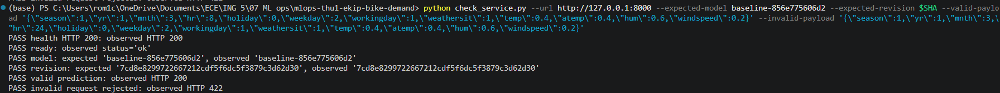
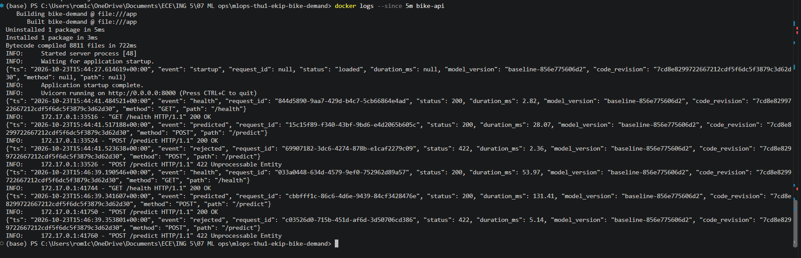

# Lab 5 contract (agreed by the team before coding)

Decided on 2026-10-23 by Jerry, Romain, Brett and Mathis. Week 3 lead: Brett; main reviewer: Romain.
Each PR of Lab 5 must follow these names. Changing one requires telling the team first.

| # | Decision | Choice | Rejected option and why |
|---|---|---|---|
| 1 | "Deployed" | Two targets, same image and same check. **Local**: the image built from a known `main` commit is started with the README commands. **Cloud Run**: the same commit is built by Cloud Build and served on the URL given in the README. In both, `/health` returns `200` with the expected `model_version` and `code_revision`, and the check script exits `0` against that URL. The final check is run by a member who wrote neither the start-up nor the check. | "The container is running" or "Cloud Run shows a green revision": neither proves which model and code answer. |
| 2 | Identity | `/health` adds `model_version` (from `model-metadata.json`) and `code_revision` (full Git SHA). `status` is kept. If the revision is unknown, the service says `"unknown"` and the check must fail. | A separate `/version` endpoint: duplicates `/health`. |
| 3 | Settings | `MODEL_DIR=/app/artifacts` (volume, read-only); `GIT_SHA` as a **build** argument stored as `CODE_REVISION`; `LOG_LEVEL` at **run** time (`-e`); port fixed at 8000. | Passing the revision with `-e` at run time: anyone could claim a wrong revision for a given image. |
| 4 | Expected values | Expected model = `model_version` printed by the training step; expected revision = `git rev-parse HEAD` of the built commit. Both are passed **as arguments** to the check script. | Hard-coded in the script (wrong after retraining); asked to the service itself (circular). |
| 5 | Log line | One JSON line per request on stdout: `ts`, `event` (`predicted`, `rejected`, `model_unavailable`, `health`, plus `startup`), `request_id`, `method`, `path`, `status`, `duration_ms`, `model_version`, `code_revision`. Never: secrets, tokens, auth headers, environment dumps, request bodies (only the names of invalid fields). | Free text (`INFO: request ok`): hard to filter and compare. |
| 6 | Failure to provoke | Run an image whose `GIT_SHA` differs from the expected one: the check must fail on the revision line and the logs must show the real revision. Alternative: start without the volume (`503` + `startup` log "model not loaded"). | — |
| 7 | Model on Cloud Run | The Lab 4 model files (`model.joblib`, `model-metadata.json`) are uploaded to a Cloud Storage bucket mounted read-only at `/app/artifacts`; no retraining. Container port set to 8000. Project: the instructor's shared project `mlops-ece-group2-and-group3`, region europe-west1; our resources contain `thu1-ekip` (service `mlops-thu1-ekip-bike-demand`, bucket `thu1-ekip-bike-demand-model`). The service requires authentication (instructor's choice): callers send a Google identity token (`gcloud auth print-identity-token`); the token is never logged. The service account only gets `roles/storage.objectViewer` on our bucket. | Training during the build (breaks "do not retrain"); committing the model to Git (large, untrusted joblib). |


## Owners (updated 2026-10-23: Jerry and Mathis swapped)

| Part | Owner | Reviewer |
|---|---|---|
| Start-up + identity (decisions 2–3) | Jerry | Brett |
| External check script (decision 4) | Brett | Romain |
| Logging (decision 5) | Mathis | Jerry |
| README "Deploy" + team report Lab 5 | Romain | Mathis |
| Cloud Run deployment (decision 7) | Jerry | Brett |

Merge order: start-up → check → logging → README.

## Evidence and Verification Record

### 1. Provenance Chain (Commit -> Image -> Run)

#### Commit
```bash
$ git rev-parse HEAD
7cd8e8299722667212cdf5f6dc5f3879c3d62d30
```

#### Image
```bash
$ docker inspect --format '{{.Id}}' bike-demand:local
sha256:e4c6dc9df8e9170e702e0997fe4cb5bbeacc04639e2f60b081451d37cacb3c80
```

#### Run (Local External Check)
```text
$ python check_service.py \
    --url [http://127.0.0.1:8000](http://127.0.0.1:8000) \
    --expected-model baseline-856e775606d2 \
    --expected-revision 7cd8e8299722667212cdf5f6dc5f3879c3d62d30 \
    --valid-payload '{"season":1,"yr":1,"mnth":3,"hr":8,"holiday":0,"weekday":2,"workingday":1,"weathersit":1,"temp":0.4,"atemp":0.4,"hum":0.6,"windspeed":0.2}' \
    --invalid-payload '{"season":1,"yr":1,"mnth":3,"hr":24,"holiday":0,"weekday":2,"workingday":1,"weathersit":1,"temp":0.4,"atemp":0.4,"hum":0.6,"windspeed":0.2}'

PASS health HTTP 200: observed HTTP 200
PASS ready: observed status='ok'
PASS model: expected 'baseline-856e775606d2', observed 'baseline-856e775606d2'
PASS revision: expected '7cd8e8299722667212cdf5f6dc5f3879c3d62d30', observed '7cd8e8299722667212cdf5f6dc5f3879c3d62d30'
PASS valid prediction: observed HTTP 200
PASS invalid request rejected: observed HTTP 422
```



---

### 2. Structured Log Evidence (JSON on stdout)

Extracted from `docker logs --since 5m bike-api`:

```json
{"ts":"2026-10-23T15:44:41.484521+00:00","event":"health","request_id":"844d5890-9aa7-429d-b4c7-5cb66864e4ad","status":200,"duration_ms":2.82,"model_version":"baseline-856e775606d2","code_revision":"7cd8e8299722667212cdf5f6dc5f3879c3d62d30","method":"GET","path":"/health"}
{"ts":"2026-10-23T15:44:41.517188+00:00","event":"predicted","request_id":"15c15f89-f340-43bf-9bd6-e4d2065b605c","status":200,"duration_ms":28.07,"model_version":"baseline-856e775606d2","code_revision":"7cd8e8299722667212cdf5f6dc5f3879c3d62d30","method":"POST","path":"/predict"}
{"ts":"2026-10-23T15:44:41.523638+00:00","event":"rejected","request_id":"69907182-3dc6-4274-878b-e1caf2279c09","status":422,"duration_ms":2.36,"model_version":"baseline-856e775606d2","code_revision":"7cd8e8299722667212cdf5f6dc5f3879c3d62d30","method":"POST","path":"/predict"}
```



---

### 3. Observed and Understood Failures

1. **Missing Artifacts Volume (HTTP 503):** Starting without the mounted volume returned HTTP 503 and emitted structured log events `startup: unavailable` and `model_unavailable`.
2. **Cloud Run Port Mismatch (8080 vs 8000):** Cloud Run routes to port 8080 by default. Aligning the container port setting to 8000 fixed the startup crash.
3. **Missing GCS Permissions:** The Cloud Run service account required `roles/storage.objectViewer` on the bucket `thu1-ekip-bike-demand-model` to mount artifacts without retraining.
4. **Deliberate Failure (Altered Code Revision):** Starting an image built with `GIT_SHA=badsha000` resulted in an immediate revision mismatch caught by the check script (exit code 1):
   ```text
   FAIL revision: expected '7cd8e8299722667212cdf5f6dc5f3879c3d62d30', observed 'badsha000'
   ```


---

### 4. Operational Boundaries

- Cloud Run IAM access is restricted to Jerry on the instructor's project `mlops-ece-group2-and-group3`. Cloud Run verification was validated via screen sharing with the team.
